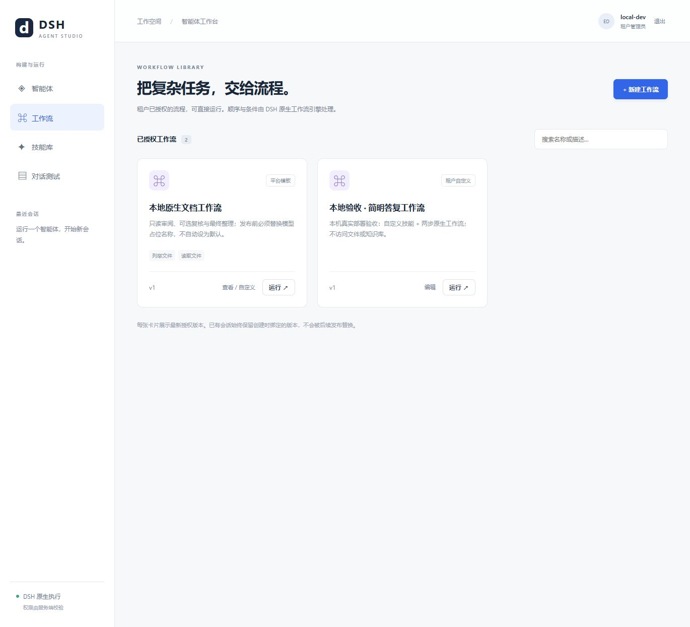
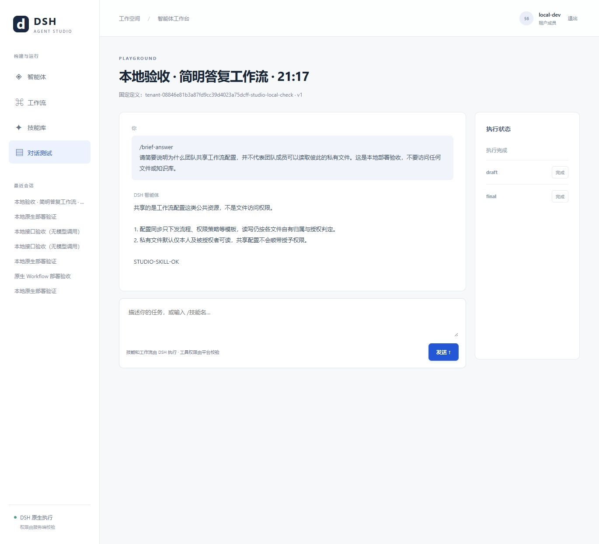

# Agent Studio（智能体工作台）实现与启用说明

更新日期：2026-10-14。

## 1. 交付与当前状态

已新增 `dsh-agent-web`（网页工作台），并补齐后端协议及受限发布实现，不是只有页面的静态演示。

| 页面 | 已实现功能 |
| --- | --- |
| 智能体 | 租户已授权定义、搜索、从模板创建、编辑租户自定义版本、运行 |
| 工作流 | 已有流程、1–8 步顺序流程编辑、条件跳过、步骤工具和调用预算、运行 |
| 技能库 | 从已授权定义发现技能；编辑页新增、移除及导入 Markdown（轻量标记语言）或纯文本技能 |
| 对话测试 | 指定版本会话、发送消息、运行状态、正文预览、终态及步骤状态、取消与历史恢复 |

**代码、隔离测试与本机持久启用已完成。** 用户明确批准后，已新增独立 `studio-admin`（工作台管理员）、执行增量迁移、重启相关后端并启动网页服务；两个既有用户仍是普通成员。真实浏览器已验证管理员发布、成员选择工作流、原生技能调用与 DeepSeek 模型执行。此结论不等同于生产或高并发验收。

遵循 Sites（网站开发技能）的本地开发与预览流程；未注册或发布外部托管网站。

## 2. 服务职责与低耦合边界

| 项目 | 本次职责 | 不负责 |
| --- | --- | --- |
| `dsh-agent-web` | 表单、目录、授权码登录、同源转发、实时展示 | 数据库、模型密钥、权限最终判定、工作流编排 |
| `dsh-agent-api` | 身份和角色校验、输入验证、转发 | 保存定义、版本分配、步骤执行 |
| `dsh-agent-catalog` | 模板授权、受限派生、不可变发布、版本控制、元数据 | 执行模型或任意插件代码 |
| `dsh-agent-chat` | 选择已授权精确版本、会话绑定、幂等和历史 | 切换租户默认值、解释步骤逻辑 |
| `dsh-agent-runtime-dsh` | 继续调用 DSH（DeepSeek 智能体执行框架）原生技能与工作流 | 接收任意上传脚本或宿主目录 |
| `dsh-agent-iam` | Keycloak（身份管理平台）签发用户及租户角色 | 接受浏览器自报角色 |

前端仅调用公共 HTTP（超文本传输协议）接口；服务间沿用既有独立签名凭据。租户来自已验证令牌，不接受请求正文指定其他租户。

## 3. 权限与能力上限

普通租户成员可查看并运行本租户授权的 Agent（智能体）或 Workflow（工作流）。创建会话提交 `definition: { id, version }`（定义标识与版本），后端重新检查授权；未授权返回 404。

`tenant-admin`（租户管理员）可发布本租户自定义定义。API（业务聚合接口）和定义中心双重校验；会话服务、运行控制服务的内部凭据不能发布。

派生必须来自**当前租户已授权的平台模板**，不能把另一份租户自定义定义当作授权模板。允许修改名称、描述、系统提示词、文本技能和受约束步骤，但：

- 模型供应商、模型名、总调用次数、输出词元与超时继承模板，不能自由更换或扩大。
- 工具只能选模板的子集；步骤工具再受智能体工具限制。
- 知识源继承模板，实际检索继续检查使用者的来源权限。
- 不开放 Shell（命令解释器）、任意 MCP（模型上下文协议）服务器、远程技能下载或本机目录。

共享的是已发布配置，不是成员文件和会话权限。配置正文对授权租户成员可见，不能存放秘密。本地身份域只有 `local-dev` 测试租户；生产身份系统必须保证角色作用域匹配令牌中的当前租户，不能把全局角色复制到任意租户。

## 4. 数据与版本设计

定义中心新增迁移 `002_studio.sql`（工作台元数据迁移），创建 `catalog.studio_agents`，保存租户、短名称、最新版本、基础模板版本、最近发布者和时间。正文仍在不可变定义表，授权仍在既有租户授权表，不新增跨服务共享数据库。

服务端用租户散列与短名称生成定义标识，不同租户的同名智能体不会共用版本。首次 `expectedVersion=0`（预期不存在）；更新必须匹配当前版本，新版本加一。丢失响应后精确重放相同请求，在该版仍是最新时返回原结果；冲突返回 409，不覆盖旧版。正文、授权和元数据在同一事务内提交，并复用租户锁。

发布不改变租户默认智能体和旧会话绑定。页面卡片显示最新授权版本；已有会话继续使用原版本。

**撤销基础模板不会级联撤销已发布派生定义**，只阻止之后基于它发布。运维若需停止派生定义的新使用，应明确撤销该定义的租户授权；在途冻结运行还需取消。此版未提供网页撤销、删除及平台模板授权管理。

每租户仍最多 100 个授权版本。未发布草稿只在页面内存，刷新会丢失，离开时提示。最近发布者记录不等同于完整历史发布审计流水；后者仍需另行扩展。

## 5. 技能与原生工作流

技能支持名称、描述、指令、模型按需加载和 `/技能名` 显式调用策略。每个智能体最多 10 个技能，每个正文最多 8,000 字符。导入 `.md`／`.txt` 均作为纯文本，包括头部文本，不自动安装技能包或执行 `scripts/`（脚本目录）。

技能仍由 DSH 原生注册表和加载器处理，显式调用是上下文注入，不保证出现技能工具事件。技能库汇总的是授权定义携带的技能，不是独立技能市场；技能随定义版本发布。

工作流可设置步骤标识、指令、最大调用次数、工具和 `whenPreviousContains`（上一成功步骤包含指定文本才执行）。首步不允许条件、步骤标识唯一、调用总和不能超过模板预算；支持添加、上移、删除。

前端不上传 JavaScript（脚本语言）工作流源代码；平台只保存数据，顺序、条件及子智能体执行继续由原生 DSH 负责。此版不是任意连线 DAG（有向无环图）编辑器，不含循环、人工审批或失败补偿。

## 6. 公共接口变化

| 方法与路径 | 用途 |
| --- | --- |
| `GET /api/v1/studio` | 开关、当前角色发布权限、本租户自定义元数据 |
| `POST /api/v1/studio/agents` | 管理员受限创建／发布新版本 |
| `GET /api/v1/definitions` | 新增 `kind=agent/workflow`（智能体／工作流类型） |
| `POST /api/v1/sessions` | 可选定义引用；省略时保持默认行为 |

会话幂等哈希包含定义选择；同键换定义会冲突。已成功重放不重新绑定、不依赖定义中心在线；新请求遇到授权撤销会失败。已更新 [OpenAPI（开放接口规范）](../dsh-agent-contracts/openapi.json)。

## 7. 登录和实时反馈

使用 OAuth（开放授权）授权码与 PKCE（授权码交换证明密钥），回调校验状态。访问和刷新令牌只在页面内存，临时校验值短暂存于会话存储，不保存用户口令。刷新页面需重新登录。退出工作台不自动退出身份平台其他应用。

网页进程只代理固定业务、事件及身份端点，转发白名单头，不转发 Cookie（浏览器会话标识）或自报租户头。设置 CSP（内容安全策略）、禁止外部嵌入、校验主机和来源。用户、模型和技能文本使用文本节点显示，不解释成 HTML（超文本标记语言）。

消息受理后显示排队，通过 SSE（服务器发送事件）接收状态与正文，断开携带游标重连；每 3 秒查询当前运行作为恢复通道。终态以服务端结果为准，不把模型私有推理当作公开思考过程。消息网络失败后重试保留原幂等键。

退出只关闭连接，不取消后台运行；可重新登录从最近会话恢复。三秒轮询用于功能联调，不代表万级连接容量已验收，上线前仍需评估轮询流量、失效令牌恢复和长时间浏览器运行。

## 8. 本机启用与运维

以下命令已在用户明确批准后执行成功。其影响是新增特权测试账号、增加定义中心写池、增量迁移数据库，并定向重启相关在线应用；不是仅启动临时演示页面。

```powershell
cd D:\code\dsh
npm run build

# 基础服务和身份平台已运行时
node dsh-agent-deploy/native/studio.mjs setup
.\dsh-agent-deploy\native\platform.ps1 -Action Restart -Services catalog,chat,api,web
```

初始化将补齐租户管理员角色，创建独立 `studio-admin` 用户和随机口令。凭据仅存于受保护的 `.local/native/platform.json`，不打印，不提升既有用户权限；同名账号不在本地管理记录时拒绝接管。

它执行定义中心增量迁移并打开本地 `studioEnabled`（发布开关），保留原定义、默认值和会话。启用后访问 `http://localhost:3000`；已有公共身份客户端允许此地址的 `/callback`（登录回调），无需通配回调或公网监听。

默认 `DATABASE_URL`（数据库连接串）仍用只读账号。可选 `CATALOG_STUDIO_DATABASE_URL`（工作台写连接）提供独立写池，未配置时关闭发布。本地脚本使用定义中心管理账号，没有扩大原只读账号权限；生产应另设只有必需表权限的运行写账号，避免在线使用模式所有者。

原生脚本新增定向 `Restart`（重启）：核实进程身份后请求优雅退出，超时失败而非强杀。以后 `Start`（启动）、`Status`（状态）、`Stop`（停止）会包含网页服务。

## 9. 本轮验证记录

| 检查 | 结果及边界 |
| --- | --- |
| 类型检查与构建 | 通过；12 个包包含协议、10 个后端及网页服务 |
| 完整回归 | 137 通过、0 失败、0 跳过；真实临时 NATS（消息代理）项已启用 |
| 授权与发布 | 管理员／成员、跨租户、内部凭据隔离、模板授权、工具提升拒绝、版本冲突和重放通过 |
| 会话选择 | 指定授权工作流、未授权拒绝、不改默认、幂等绑定通过 |
| 浏览器交互 | 内存夹具模拟登录、技能修改、流程启用、确认发布、新卡片、选择运行和完成状态通过 |
| 静态页面 | 临时本机 3000 端口响应 200，首页已查看 |
| 真实持久部署与模型 | 已通过：真实管理员页面发布 `studio-local-check` v1，普通成员运行两步工作流；`draft`、`final` 均完成，最终回答包含自定义技能标识 `STUDIO-SKILL-OK` |

```powershell
$env:NATS_SERVER_BIN = "D:\code\dsh\.tools\nats-2.15.0\nats-server-v2.15.0-windows-amd64\nats-server.exe"
npm test
```

真实本机部署页面证据：





早期内存模拟页面证据（不是上述真实模型结果）：


未覆盖：移动实机、多浏览器兼容、文件上传浏览器自动化、刷新令牌长期失效、真实故障和高并发。临时预览与夹具已关闭；正式本地服务按用户要求保留运行。验收工作流及其合成会话保留，便于复查。

## 10. 提交后重复验收

2026-10-14 已完成工作台 7 组真实验收，结果和完整平台复测见[复测报告](testing/local-test-report-2026-10-14.zh-CN.md)。重复运行入口：

```powershell
node dsh-agent-deploy/native/studio-test.mjs --live-model
```

脚本不自动创建账号或发布新定义，使用本机已通过网页发布的 `studio-local-check` v1：基础模板为 `local-agent` v1、无工具、两个步骤标识为 `draft`（初稿）与 `final`（最终答复）；`brief-answer`（简明答复）技能允许用户显式调用，指令包含最终输出 `STUDIO-SKILL-OK` 验收标识。全新环境需先在工作台准备同样的合成定义。

脚本检查发布请求精确重放和冲突拒绝，不增加定义版本、不切换默认值；新增一条本人成员会话，保留运行记录。默认不调用模型，传入 `--live-model` 才执行两步真实模型并复核同源 SSE（服务器发送事件）代理和游标恢复。不要在生产环境使用合成验收账号与定义。
